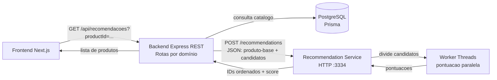

# artpop

Marketplace de arte autoral e artesanato, criado para aproximar pessoas interessadas em peças feitas à mão dos artesãos que as produzem.

## Descrição

O artpop organiza em uma vitrine digital obras autorais de diferentes categorias, técnicas e municípios. A pessoa visitante pode descobrir peças, pesquisar por nome, técnica ou localidade, filtrar o catálogo e consultar os detalhes de cada produto. O artesão pode apresentar seu perfil, publicar novos anúncios e gerenciar o estoque. O comprador pode adicionar produtos ao carrinho e simular a compra.

A aplicação resolve o problema da pouca visibilidade de pequenos produtores e da dificuldade de encontrar arte local em um único lugar. Ao reunir catálogo, contexto sobre a peça e informações do artesão, o projeto facilita a descoberta e valoriza o trabalho manual.

> **Estado atual:** o frontend mantém compatibilidade com a Fake API durante o desenvolvimento, enquanto o backend REST com PostgreSQL, Prisma e autenticação JWT já possui implementação executável. A integração final depende da configuração do banco e das variáveis de ambiente.

## Integrantes

| Integrante | Perfil | Foto |
| --- | --- | --- |
| Davi Lucas Da Silva Pinheiro| [github.com/davi081dev](https://github.com/davi081dev) | <a href="https://github.com/davi081dev"></a> |
| Hugo Mendonça | [github.com/BRKHugz](https://github.com/BRKHugz) | <a href="https://github.com/BRKHugz"></a> |
| Luiz Fernando Ramos de Toledo | [github.com/FernandoToledo69](https://github.com/FernandoToledo69) | <a href="https://github.com/FernandoToledo69"></a> |
| Michel dos Santos Serpa | [github.com/serpamichel](https://github.com/serpamichel) | <a href="https://github.com/serpamichel"></a> |

### Equipe das disciplinas de Algoritmos e Estruturas de Dados e Infraestrutura de Software

Disciplinas ministradas pelo Professor David Cunha.

| Integrante | Perfil | Foto |
| --- | --- | --- |
| José Leandro Ventura Rocha da Silva | [github.com/injuje](https://github.com/injuje) | <a href="https://github.com/injuje"></a> |
| Felipe Lopes de Vasconcelos | [github.com/FelipeLV12](https://github.com/FelipeLV12) | <a href="https://github.com/FelipeLV12"></a> |

## Tecnologias utilizadas

### Frontend

- Next.js 16.3.6
- React 18.3.1
- TypeScript 5.6.3
- CSS global próprio e App Router do Next.js

### Persistência e experiência atual

- `localStorage` do navegador para armazenar perfil do artesão, obras publicadas e carrinho durante o protótipo.
- Dados mockados para demonstrar o catálogo inicial.
- `FileReader` para transformar imagens selecionadas em Data URLs no navegador.
- Fake API de autenticação, pedidos, pagamentos, artesãos, recomendações e administração.

### Estrutura prevista

O diretório `backend/` contém uma API REST em Express, Prisma ORM, PostgreSQL, autenticação JWT, autorização por papel e documentação OpenAPI. Cache, filas e integrações externas continuam opcionais e não são requisitos básicos desta entrega.

## Como executar localmente

### Frontend

Pré-requisitos: Node.js 18.17 ou superior e npm.

```bash
cd frontend
npm install
npm run dev
```

Depois, abra [http://localhost:3000](http://localhost:3000).

Para gerar e executar a versão de produção:

```bash
cd frontend
npm run build
npm start
```

### Backend

Pré-requisitos: Node.js 18+ e PostgreSQL.

```bash
cd backend
copy .env.example .env
npm install
npm run prisma:generate
npm run prisma:migrate
npm run prisma:seed
npm run dev
```

A API ficará disponível em `http://localhost:3333`. O PostgreSQL pode ser iniciado com `docker compose up -d postgres`.

## Variáveis de ambiente

O protótipo frontend não exige variáveis de ambiente: os dados são mockados ou armazenados localmente no navegador.

O arquivo [`.env.example`](.env.example) registra a configuração opcional que poderá ser usada quando a API for implementada:

```dotenv
# URL base da API. Não é necessária no protótipo atual.
NEXT_PUBLIC_API_URL=http://localhost:3333
```

Para usar o arquivo localmente, copie-o para `.env.local` dentro de `frontend/`:

```bash
copy ..\.env.example .env.local
```

No PowerShell, o mesmo comando pode ser executado a partir do diretório `frontend`. Com `NEXT_PUBLIC_API_URL` configurada, a seção de recomendações na página de produto consulta a API REST. Sem ela, o protótipo continua usando os dados locais.

Para a fila de curadoria, configure `NEXT_PUBLIC_API_URL` no frontend e os parâmetros `SMTP_HOST`, `SMTP_PORT`, `SMTP_USER`, `SMTP_PASSWORD` e `SMTP_FROM` no `backend/.env`. A aprovação exige autenticação administrativa; a reprovação só é concluída depois que o e-mail de justificativa é enviado.

## Funcionalidades implementadas

### Vitrine e descoberta de produtos

- Vitrine inicial com obras demonstrativas e obras publicadas pelo artesão.
- Banner de destaque ("Encontre uma peça com alma") exibido apenas na página inicial sem filtros ativos — ocultado automaticamente ao buscar ou filtrar.
- Busca por nome da obra, técnica ou município.
- Filtros por município, categoria, técnica e ordenação (mais recentes, mais antigas, menor preço, maior preço, ordem alfabética).
- Contagem dinâmica de resultados encontrados com texto acessível.

### Página de detalhes da obra

- Exibição completa: imagem principal, galeria de imagens adicionais, título, descrição, preço, técnica, município e artesão.
- Aviso de **"último item disponível"** (em destaque vermelho) quando o estoque for igual a 1.
- Seletor de quantidade integrado ao botão de "Adicionar ao carrinho", respeitando o limite do estoque disponível.
- Botão de aplauso (👏) posicionado no canto superior direito da imagem, com tooltip "aplaudir" ao passar o mouse, idêntico ao da vitrine.
- Seção de informações do artesão com link para o perfil.
- Formulário de comentários e avaliações.

### Carrinho de compras

- Adicionar itens ao carrinho com quantidade definida pelo usuário.
- Remover itens individualmente.
- Ajustar quantidade diretamente no carrinho, respeitando o estoque disponível.
- Agrupamento de itens por artesão.
- Cálculo de subtotal em tempo real.
- Campo para inserção de cupom de desconto.
- Cálculo de frete simulado por CEP (PAC e Sedex) na página da obra e no carrinho, considerando peso e volume dos itens e exibindo o custo total da compra.
- Estado vazio com chamada para explorar obras.
- O visitante pode navegar e adicionar produtos ao carrinho sem estar autenticado.
- A finalização da compra exige uma sessão ativa e redireciona visitantes para `/login`.

### Checkout e pagamentos

- Checkout protegido para usuários autenticados.
- Opções de Pix, cartão de crédito e cartão de débito.
- Pix com chave de pagamento, botão para copiar a chave e QR Code simulado.
- Cartões com tokenização simulada, armazenamento apenas da bandeira e últimos quatro dígitos.
- Botão de finalizar compra disponível junto ao salvamento do cartão.
- Cinco cupons fictícios disponíveis no carrinho: `ARTPOP10`, `BEMVINDO15`, `FEITOAMANO20`, `FRETEGRATIS` e `CULTURA25`.
- Pedido criado somente quando há usuário autenticado e itens no carrinho.

### Autenticação, privacidade e segurança

- Cadastro de comprador ou artesão com nome, e-mail, telefone, CPF e senha.
- Validação de CPF e telefone no cadastro.
- Senhas armazenadas como hash SHA-256 na Fake API, sem texto puro.
- JWTs de acesso com validade de 15 minutos e renovação automática por refresh token persistente em cookie `HttpOnly` por até 30 dias.
- Bloqueio temporário após cinco tentativas de login inválidas.
- CPF armazenado como hash e últimos quatro dígitos; telefone armazenado mascarado.
- Consentimento para tratamento de dados e página de [política de privacidade](frontend/src/app/privacidade/page.tsx).
- Logout revoga a sessão de refresh no backend e limpa a sessão local, o carrinho, o frete selecionado e o cartão salvo do navegador.

> **Limitação de segurança:** o modo Fake API ainda usa `localStorage` e serve apenas para prototipagem. Com o backend configurado, o JWT de acesso fica apenas em memória no frontend e o refresh token fica em cookie `HttpOnly`; em produção, configure HTTPS, `NODE_ENV=production`, `CORS_ORIGIN` e `NEXT_PUBLIC_API_URL`.

### Perfil e painel do artesão

- Visualização e edição dos dados do perfil (nome, cidade, bio e foto de avatar).
- Publicação de obras com validação de campos obrigatórios (título, categoria, técnica, descrição, preço, estoque, foto principal, peso e dimensões da embalagem).
- Upload local de até cinco fotos no total, incluindo a principal; a primeira foto adicionada vira automaticamente a principal, e as demais podem ser reordenadas ou promovidas à principal.
- Listagem das obras publicadas com busca por nome, categoria ou técnica.
- Controle de estoque: atualização de quantidade com confirmação e feedback visual.
- Links **"Editar"** e **"Ver anúncio"** alinhados lado a lado em cada obra listada, para editar ou acessar a página pública do produto.

### Curadoria de artesãos

- Novos cadastros de artesão ficam pendentes até a aprovação de uma conta administrativa.
- A fila `/api/admin/artesaos/pendentes` e as ações de aprovação/reprovação são protegidas por autenticação e papel `ADMIN`.
- Apenas artesãos aprovados e seus produtos são retornados pelas rotas públicas do backend.
- A reprovação exige justificativa e envio de e-mail via SMTP; sem SMTP configurado, o cadastro permanece pendente e a API informa o erro.

### Navegação e experiência

- Títulos de página HTML únicos e descritivos para cada rota (ex.: "Carrinho | artpop", "Detalhes da Obra | artpop").
- Página 404 personalizada com mensagem amigável e ilustração do cacto, no lugar da tela genérica de erro.
- Breadcrumbs nas páginas internas para facilitar a navegação.
- Layout responsivo: funciona em desktop e mobile.
- Painel administrativo com estrutura inicial de rotas.
- Cabeçalho público com `Entrar`, `Cadastrar-se` e `Carrinho` para visitantes.
- Cabeçalho mínimo, centralizado e sem rodapé nas páginas de login e cadastro.
- Indicadores de desenvolvimento do Next.js não fazem parte do deploy de produção.

### Estrutura de dados (Fake API)

- Camada de `services` organizada por domínio em `src/services/api/`:
  - `produtos.service.ts` — CRUD de obras via `localStorage`.
  - `carrinho.service.ts` — Leitura, adição, remoção e atualização de itens do carrinho.
  - `usuarios.service.ts` — Leitura e atualização do perfil do artesão.
  - `favoritos.service.ts` — Controle de aplausos/favoritos.
  - `auth.service.ts` — Cadastro, login, logout, expiração de sessão e limitação de tentativas.
  - `pedidos.service.ts` — Pedidos, tokenização simulada, Pix, cartões e proteção de compra autenticada.
  - `artesoes.service.ts` — Listagem e consulta de perfis públicos de artesãos.
  - `recomendacoes.services.ts` — Produtos relacionados.
  - `admin.service.ts` — Indicadores, catálogo e atualização de status de pedidos.
  - `client.ts` — Reservado para o cliente HTTP do backend futuro.
- Dados mockados em `src/mocks/products.ts` simulando obras de diferentes artesãos, cidades e categorias.
- Tipos e interfaces centralizados em `src/types/` para os principais recursos (Produto, CartItem, etc.).
- Estrutura preparada para substituição da Fake API pelo backend real na Avaliação 2, sem necessidade de reescrever a estrutura principal.

## Rotas da aplicação

| Rota | Descrição |
| --- | --- |
| `/` | Página inicial com vitrine e filtros |
| `/produtos/[id]` | Detalhes de um produto |
| `/artesoes` | Listagem de artesãos |
| `/artesoes/[id]` | Perfil público de um artesão |
| `/carrinho` | Carrinho de compras |
| `/checkout` | Checkout protegido por autenticação |
| `/login` | Login do usuário |
| `/cadastro` | Cadastro de comprador ou artesão |
| `/pedidos` | Histórico de pedidos do comprador |
| `/pedidos/[id]` | Detalhes de um pedido |
| `/aplausos` | Obras aplaudidas pelo usuário |
| `/painel-artesao` | Painel inicial do artesão |
| `/painel-artesao/anunciar` | Formulário para publicar obra |
| `/painel-artesao/editar/[id]` | Edição de obra publicada |
| `/painel-artesao/pedidos` | Pedidos recebidos pelo artesão |
| `/admin` | Painel administrativo (estrutura inicial) |
| `/privacidade` | Informações de privacidade e tratamento de dados |

## Rotas da API

Os endpoints HTTP estão implementados em `backend/src/routes/`. O catálogo, autenticação, carrinho, artesãos, pedidos, avaliações, recomendações e administração estão disponíveis sob o prefixo `/api`.

As operações atualmente disponíveis acontecem no cliente:

| Operação | Serviço | Armazenamento |
| --- | --- | --- |
| Listar e filtrar obras | `MarketplaceProducts.tsx` | Mocks + `localStorage` (`origem:products`) |
| Publicar obra | `produtos.service.ts` | `localStorage` (`origem:products`) |
| Atualizar estoque | `produtos.service.ts` | `localStorage` (`origem:products`) |
| Ler e atualizar perfil | `usuarios.service.ts` | `localStorage` (`origem:artisan-profile`) |
| Adicionar/remover do carrinho | `carrinho.service.ts` | `localStorage` (`origem:cart`) |
| Calcular frete (simulado) | `carrinho.service.ts` | Cálculo local por CEP |
| Aplausos/favoritos | `favoritos.service.ts` | `localStorage` (`origem:favorites`) |
| Cadastro e login | `auth.service.ts` | `localStorage` (`origem:accounts`, `origem:session`) |
| Criar pedido | `pedidos.service.ts` | `localStorage` (`origem:orders`), somente autenticado |
| Pix e métodos de pagamento | `PaymentForm.tsx` / `pedidos.service.ts` | Simulação local e QR Code externo |

O endpoint de recomendações é consumido pela página de produto quando a URL da API está configurada. A seção do Projeto Integrador abaixo documenta a comunicação e o benchmark.

## Projeto Integrador — Parte 2 (Unidade 2)

### Arquitetura distribuída



- **Frontend:** apresenta o catálogo e solicita recomendações ao backend via HTTP; o restante do protótipo continua compatível com a Fake API.
- **Backend REST:** mantém rotas e regras de domínio, consulta o catálogo no PostgreSQL e monta a resposta pública. Não executa o cálculo CPU-bound.
- **Recommendation Service:** processo independente e sem estado persistente; recebe os dados necessários por HTTP, calcula similaridade por categoria, texto, faixa de preço e artesão, e devolve os IDs ranqueados. Pode ser escalado sem replicar a API nem dar acesso ao banco.
- **Worker Threads:** paralelizam o cálculo em blocos e ficam aquecidas entre requisições. São paralelismo dentro do serviço, não microsserviços adicionais.
- **PostgreSQL:** continua sendo a fonte de verdade; o serviço de recomendação não acessa o banco diretamente.

O frontend usa `GET /api/recomendacoes?productId=<id>` quando `NEXT_PUBLIC_API_URL` está definida. O backend chama o serviço por `POST /recommendations`; a URL pode ser configurada em `RECOMMENDATION_SERVICE_URL` (padrão local `http://127.0.0.1:3334`). Configure `RECOMMENDATION_HOST` e `RECOMMENDATION_PORT` para a implantação.

### Onde está implementado

- Cliente HTTP entre backend e serviço: [`backend/src/integrations/recommendation.client.ts`](backend/src/integrations/recommendation.client.ts).
- Endpoint REST do catálogo: [`backend/src/routes/recomendacoes.routes.ts`](backend/src/routes/recomendacoes.routes.ts).
- Servidor de recomendações: [`backend/src/recommendation-service/server.ts`](backend/src/recommendation-service/server.ts).
- Distribuição da pontuação em workers: [`backend/src/recommendation-service/scoring.ts`](backend/src/recommendation-service/scoring.ts) e [`backend/src/recommendation-service/scoring.worker.ts`](backend/src/recommendation-service/scoring.worker.ts).
- Integração na página de produto: [`frontend/src/services/api/recomendacoes.services.ts`](frontend/src/services/api/recomendacoes.services.ts) e [`frontend/src/components/marketplace/ProductDetail.tsx`](frontend/src/components/marketplace/ProductDetail.tsx).
- Benchmark reproduzível: [`backend/src/scripts/benchmark-recommendations.ts`](backend/src/scripts/benchmark-recommendations.ts).

### Como executar e conferir a comunicação

Inicie o PostgreSQL com `docker compose up -d postgres`. Depois, com o PostgreSQL disponível, inicie o serviço de recomendação e a API em terminais separados:

```powershell
cd backend
copy .env.example .env
npm ci
npm run prisma:generate
npm run prisma:deploy
npm run build
npm run start:recommendations
```

Em outro terminal, inicie a API (`npm run dev`, ainda em `backend`) e configure `NEXT_PUBLIC_API_URL=http://localhost:3333` em `frontend/.env.local`. Ao abrir uma página de produto, a interface chama a rota REST e o backend chama o serviço de recomendação. O benchmark abaixo também executa chamadas HTTP reais usando o mesmo cliente de integração do backend; ele não exige banco de dados.

Alternativamente, para subir PostgreSQL, backend e serviço de recomendação em uma rede única:

```powershell
docker compose up -d --build
curl http://localhost:3333/health
curl http://localhost:3334/health
```

Para encerrar os serviços:

```powershell
docker compose down
```

### Metodologia e resultados do benchmark

Após `npm ci` e `npm run prisma:generate` em `backend/`, execute `npm run benchmark:recommendations`. O comando compila e executa o serviço em uma porta local aleatória, sem exigir PostgreSQL. O script envia **40.000 produtos sintéticos** por HTTP e solicita as mesmas oito recomendações em modo sequencial e paralelo. Há uma chamada de aquecimento por modo e cinco repetições medidas; a ordem alterna entre repetições. A latência HTTP é medida com `performance.now()` em torno da chamada `fetch` (inclui serialização JSON, ida e volta local e processamento). O próprio serviço também mede o tempo de pontuação, excluindo o transporte HTTP. Comparamos a mediana das cinco medições; os IDs recomendados precisam ser iguais nos dois modos. O throughput concorrente não foi medido.

Execução nesta máquina: Windows x64, Node.js v24.14.0, 12 CPUs lógicas, quatro workers. Resultado observado:

| Modo | Latência HTTP mediana | Pontuação mediana | Ganho |
|---|---:|---:|---:|
| Sequencial (1 worker) | 568,53 ms | 258,94 ms | referência |
| Paralelo (4 workers) | 448,69 ms | 198,34 ms | 1,27× HTTP; 1,31× na pontuação |

O trecho paralelo reduz o tempo de pontuação em aproximadamente **23,4%**; a resposta HTTP completa melhora **21,1%**. A diferença ocorre porque a transferência e serialização do catálogo também consomem tempo e não são paralelizadas. Em catálogos pequenos, esse custo pode superar o benefício de dividir o trabalho; a separação foi escolhida para isolar e escalar o cálculo quando o volume de candidatos cresce. Os tempos são uma medição local e não representam uma garantia de produção.

O benchmark registra a comunicação executada, por exemplo:

```text
HTTP GET /health -> 200 ok; worker slots=4
HTTP POST /recommendations -> 200 mode=sequential; repeticao=1/5
HTTP POST /recommendations -> 200 mode=parallel; workers=4
Resultados equivalentes: sim (8 recomendacoes).
```

Os resultados brutos das repetições são registrados automaticamente em [`docs/evidencias/benchmark-recomendacoes.md`](docs/evidencias/benchmark-recomendacoes.md) após executar `npm run benchmark:recommendations`.

## Deploy

O frontend está preparado para deploy em plataformas com suporte a Next.js.

### Vercel

- Root Directory: `frontend`
- Build Command: `npm run build`
- Install Command: `npm install`
- Output Directory: deixar padrão do Next.js

### Netlify

O repositório possui [netlify.toml](netlify.toml) e usa `@netlify/plugin-nextjs`.

- Base directory: `frontend`
- Build Command: `npm run build`
- Publish directory: `.next`
- Package directory: deixar vazio

Após alterar as configurações, execute um novo deploy limpando o cache do build. Configure `NEXT_PUBLIC_API_URL` no frontend para ativar a integração REST; sem ela, a Fake API local continua disponível como fallback.

## Documentação do projeto

Os documentos de apoio ao desenvolvimento estão disponíveis no Google Docs e foram produzidos no contexto das disciplinas de Requisitos, Projeto de Software e Validação (RPSV).

| Documento | Descrição |
| --- | --- |
| [Documentação inicial da Fake API](docs/fake-api.md) | Contratos atuais, persistência local, fluxos e roteiro de substituição pelo backend real. |

| Documento | Descrição | Link |
| --- | --- | --- |
| **Plano de Testes** | Define os cenários de teste para as funcionalidades da aplicação, cobrindo fluxos do comprador, artesão e administrador. | [Acessar documento](https://docs.google.com/document/d/1hCp5BICTYdz2LbNpYU1cTnWUnXM8GjpmJF-qIoFuACY/edit?tab=t.0#heading=h.8xb8w02r0qgu) |
| **Backlog Priorizado** | Lista as histórias de usuário priorizadas pela técnica MoSCoW, organizadas em épicos como Gestão de Catálogo, Vitrine, Carrinho, Perfil do Artesão e Administração. | [Acessar documento](https://docs.google.com/document/d/1rnUwuTO_7RArdPtnSpCX4NN79ZVoZcF_feb5EoC23RQ/edit?tab=t.0) |

## Evidências

- O catálogo inicial é carregado com obras demonstrativas no componente `MarketplaceProducts`.
- A publicação de uma obra exige os campos obrigatórios e mostra a mensagem de sucesso no próprio formulário.
- A imagem principal e imagens adicionais são convertidas localmente para Data URLs.
- O campo de quantidade no botão de compra respeita o estoque disponível e bloqueia quando esgotado.
- Visitantes conseguem adicionar produtos ao carrinho, mas são redirecionados ao login ao tentar finalizar a compra.
- Métodos Pix, cartão de crédito e cartão de débito estão disponíveis no checkout.
- Cinco cupons fictícios podem ser aplicados no carrinho e refletidos no total do pedido.
- O checkout redireciona usuários não autenticados para `/login` e o service de pedidos bloqueia chamadas sem sessão.
- O cadastro valida CPF e telefone, exige consentimento de privacidade e não persiste a senha em texto puro.
- O QR Code do Pix e dados da sessão são inicializados após a hidratação para evitar erros SSR/client.
- O banner de destaque desaparece automaticamente ao buscar ou filtrar obras.
- O comando de produção do frontend é `npm run build`.
- O benchmark possui logs versionados com evidências HTTP em [`docs/evidencias/`](docs/evidencias/).
